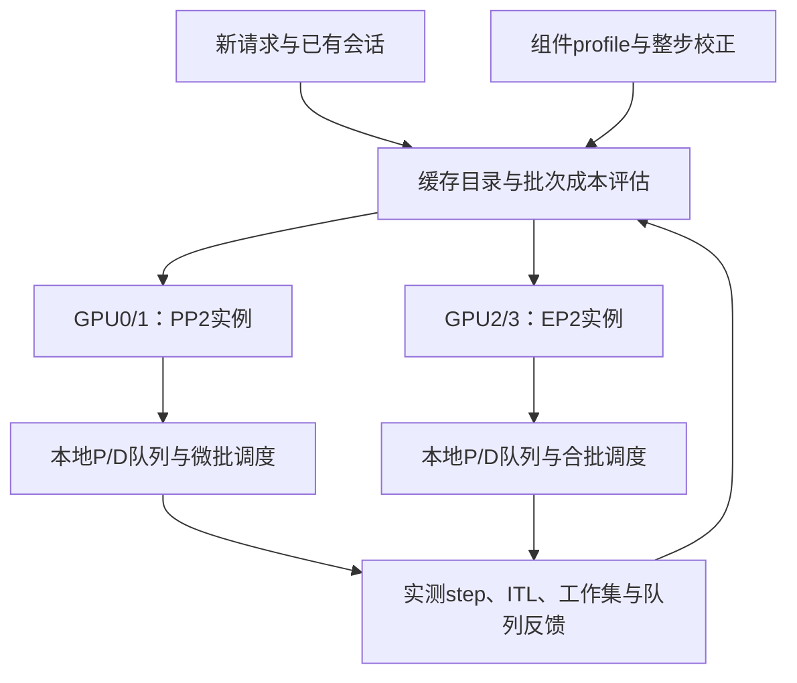

# MoE 多配置实例池与批次调度机制草案

2026-10-29。研究与设计提案；本次没有新增 GPU 测量或实现在线控制器。

建议先实现一个常驻权重的 PP/EP 多配置实例池，联合选择请求去向与批次组成，在相同 GPU 预算下最大化满足延迟目标的服务量。P/D 是调度状态和资源偏好，PP/EP 是执行布局，两者分别建模。运行时权重重分片放在后续阶段。

最值得验证的研究问题是：**MoE 实例的服务能力随实际批次的专家工作集、通信域和缓存位置变化；路由又改变这些状态，如何让路由与合批联合决策？** 多配置共存、profile 选布局、软 P/D 分工均有先例；新机制须证明额外状态与联合决策带来的实际收益。

## 现有证据与适用边界

### 已测组件能说明什么

- 单层 Expert 二维表控制本地 token–expert 行数与活跃专家数，测量权重已经驻留 GPU 时的执行。差额包含权重读取、GEMM 粒度、padding、kernel 调度等，不能全部归因于 HBM 带宽；没有测 CPU→GPU 权重加载。
- 通信表控制整个 EP 组的原始 token 数。EP2/4 在节点内 NVLink，EP8 跨两节点；大输入采用 DeepEP LL、全组 2048-token 分块。不能将这一大输入曲线当成经过充分调优的 Prefill 通信下界。
- 派生图在理想饱和流水下，把单层计算与独立通信测量组合，PP 的正预算只是可以支付未知额外开销的空间。它没有实测整模型 PP 激活交接、气泡、Attention、共执行竞争和全部 overlap。
- 例如 Graph、计算进程1、通信轮次1、事件1，35B 的 N128、EP4 对 PP4：PP 多计算 0.568512 ms、少专家通信 0.065024 ms，组件预算为 −0.503488 ms。GLM 的 N128、EP8 对 PP2×EP4：多计算 0.110912 ms、少通信 0.328192 ms，预算为 +0.217280 ms。它们是不同模型/拓扑下的例子，不能互相排序。

[组件模型与绝对数字](/data/gpfs/projects/punim2715/vllm_workbench/experiment_manager/experiments/h100_ep_pp_component_tradeoff_20261029/REPORT.md)。

### 整模型数据已经要求保留副本候选

以下从既有 35B BF16/H100 四卡实验中，固定 GPU 对0、第一正式轮提取；每个两卡组承担 B32。没有跨轮平均，也没有挑最快 GPU 对。原四卡的两个 GPU 对同时运行，因此这些是两卡组观测，不能称独占两卡实验。EP2与单卡副本的GPU对内请求组成相同，PP2采用原实验轮转分配；完整B64组成相同。Prefill 新增 Q512→输出1，Decode 新增 Q1→输出128；P 是每请求已缓存前缀。全部使用自然缓存重放，吞吐计新输入或生成输出，包含请求内 CPU 恢复时间。

| P | 阶段 | 两个单卡副本 tok/s | EP2 tok/s | PP2 tok/s | CPU前缀比例：副本 / EP2 / PP2 |
|---:|---|---:|---:|---:|---|
| 8256 | Prefill | 62867.3 | 50013.0 | 52904.1 | 0 / 0 / 0 |
| 8256 | Decode | 2782.9 | 2431.3 | 2159.3 | 0 / 0 / 0 |
| 130304 | Prefill | 7178.5 | 7610.7 | 17228.0 | 100% / 53.125% / 40.625% |
| 130304 | Decode | 318.2 | 802.5 | 808.1 | 100% / 53.125% / 46.875% |

短上下文、GPU KV 足够时，单卡副本值得保留。长上下文的差异同时包含容量、缓存和调度作用，不能解释为纯 Expert/通信收益。长上下文 Decode 中 PP2 和 EP2 接近，这组数据没有建立“长上下文一定选 PP”的规则。PP 使用该负载通过资格的原生/early-send与微批调优，不能把另一负载上的 lookahead 优化结果直接拼入。

[逐GPU对逐轮数据](/data/gpfs/projects/punim2715/vllm_workbench/engines/sglang/autoscaling/experiments/h100_five_layouts_hicache_20261028/two_gpu_three_layouts_analysis/per_group_rounds.csv) · [协议与资格说明](/data/gpfs/projects/punim2715/vllm_workbench/experiment_manager/experiments/qwen35b_h100_five_layouts_hicache_20261028/two_gpu_three_layouts_analysis/REPORT.md)。

近期 122B B32 Decode 对齐生成位置后的 profile 也说明：PP 的 GEMM 优势会被 EP 的重叠、PP 的边界和调度等待抵消。控制器必须使用实际整步服务时间校正，不能将裸 GEMM 与裸通信简单相加。[现有优化诊断](/data/gpfs/projects/punim2715/vllm_workbench/engines/sglang/autoscaling/experiments/h100_qwen122b_pp_refine_20261027/report/REPORT.md)。

## 直接相关文献和研究空间

这是截至本次检索的定向比较，不是全领域新颖性证明。论文结果未在本次复现。不同论文的提升比例不与本地数据合并。

| 工作与阅读定位 | 已有覆盖 | 对本提案的约束 |
|---|---|---|
| [OServe，ICML 2026正式版](https://proceedings.mlr.press/v306/jiang26k.html)，§3–5，App D/K，PDF pp3–6、15、21 | 异构并行配置的副本、workload分配、部署与路由联合优化、预测驱动切换；§4.2用单类容量的归一化加和描述混合容量 | 最接近实例池构想。App K 明确可加入 EP，因此“给 OServe 加 EP”不足以作为贡献。可检验固定类别容量是否在 MoE 的实际合批/工作集变化下误判，不能预先认定它失败 |
| [TEMPO v2](https://arxiv.org/html/2608.13057v2)，§2.2、4–5，Fig9 | 活跃 expert replica、tokens、padding 的联合成本，EP内 token 分配 | 二维图和权重读取平台已有先例。请求到完整实例的分配与专家到副本的分配是不同动作，但区别本身不证明收益 |
| [MoEFS v1](https://arxiv.org/html/2607.18631v1)，§III–VI | profile与成本模型，TP/PP/EP、schedule、kernel搜索，可实现性约束 | 不能把成本模型选配置作为唯一贡献。需控制相同优化程度和真正可运行的配置 |
| [PipeSwift v4](https://arxiv.org/html/2609.16491v4)，§5.2、6、7 | MoE跨节点EP与PP的阶段取舍、微批与调度，completion-oriented agentic目标 | 混合PP×EP和PP少跨域通信已有直接先例；严格流式ITL与批任务JCT应分别评价 |
| [Moebius v1](https://arxiv.org/html/2606.26607v1)，§4.5、6.1 | 按inflight batch切换TP/EP，校准阈值、KV检查、防抖和保留运行时 | batch阈值式自适应已有先例；它的实测不是PP/EP实例池，但只换候选名称也不够 |
| [DynaServe v2](https://arxiv.org/html/2504.09285v2)，§3–4 | 统一实例、micro-request、P/D灵活拆分、全局路由和SLO感知合批 | 软角色和动态P/D混部本身不新；须验证MoE布局与工作集如何改变决策 |
| [DistServe v3](https://arxiv.org/html/2401.09670v3)，§4；[Llumnix，OSDI24](https://www.usenix.org/conference/osdi24/presentation/sun-biao) | 阶段分别选并行与速率匹配；跨实例动态调度和状态迁移 | 需与调优PD和cache-aware负载均衡比较，不能只对比round-robin |
| [VAMP v1](https://arxiv.org/abs/2609.13537)，摘要及既有定向笔记 | 为保留KV动态让出expert权重显存、计入offload/重算代价 | 若研究真CPU→GPU权重加载，已进入另一条有直接先例的路线，需补加载与资源竞争实测 |

**可检验的差异：** OServe的容量抽象按workload类型组合；本提案要验证在同一类型、同样N和KV工作集下，expert histogram、实际微批切法及缓存所在实例，是否会使配置排序改变。若扩展其capacity profiling后已足够准确，应如实收窄为一个工程扩展或benchmark发现。

## 机制结构

### 实例配置与P/D角色分别表示

每实例配置记录物理GPU集合、PP stage数与层划分、每stage EP度、Attention TP/DP、精度、实际kernel、Graph模式、通信后端、KV/GDN容量和微批策略。Attention DP与MoE EP可能使用同一组GPU，不直接把各degree全部相乘。

35B第一版用同一NVLink域的4张H100。一个候选部署为GPU0/1运行PP2，GPU2/3运行EP2。公平对照至少有两个EP2、两个PP2和四个单卡副本。经资格检查后加入EP4、PP4、PP2×EP2，以及PP2加两个单卡副本。所有部署总GPU数相同，每实例均有完整逻辑模型；实例池的权重复制和KV损失计入总成本。

这是概念图，不是已实现系统。两个实例均可执行P和D。P-heavy/D-heavy表示配额和偏好；不固定PP=P、EP=D，也不要求每条请求都跨实例传KV。

GLM/HY3遵循最小EP4约束：8卡候选为EP8、PP2×EP4、两个EP4副本，不考虑纯PP。PP2×EP4将前半层放节点A的EP4组，后半层放节点B的EP4组；每层专家交换局限在节点内，节点之间传流水边界激活。它同时保留EP和PP，仍需支付节点内交换、stage交接、反馈和流水等待。

### 状态应描述实际执行批次

| 状态 | 决策用途 |
|---|---|
| 本轮新增/Decode tokens、请求数、Prefill chunk与微批数 | 决定实际GEMM和通信工作量；不是请求最终总输出长度 |
| 每请求cached context与新增Q、实际Attention/GDN后端 | 预测Attention、状态占用与每stage负载 |
| 每层每rank的expert token histogram、活跃专家数、tile数、最慢rank | 预测Expert工作集、padding和EP不均衡 |
| GPU/CPU前缀命中、KV/GDN所在实例、剩余容量 | 评估cache reuse、恢复和状态迁移 |
| 排队、TTFT/逐token deadline余量、各PP槽位就绪时刻 | 避免合批收益被等待与bubble抵消 |
| 通信域、后端/块大小、已测暴露通信和争用 | 避免把所有通信都视为可消除开销 |

相同模型同一个普通Decode step，B64通常是64个待生成token；上下文长并不把这64自动变小。长上下文可能先占满KV，导致实际可运行B下降，也可能让Attention变成主导。这两条路径都需实测，不能直接用context阈值替代。

专家路由在执行前不能准确已知。新Prefill用历史同类输入的分布与不确定性；后续Decode可用此前路由统计做预测。第一版先用粗粒度负载特征，expert histogram先只记录不控制。只有留出数据证明其预测稳定且改善决策后，再加入在线控制；不能用完整未来路由或真实输出长度作为部署时可用信息。

### 将组件表升级为整步预测

每层每rank的本地Expert成本近似为：

`G = f(assignment_rows, active_experts, expert_histogram, padded_tiles, dtype, kernel, Graph)`。

`padded_tiles = sum_e ceil(n_e / tile_size)`中的tile_size取实际kernel。HBM权重工作集随被访问的expert集合变化；不能把有效FLOPs视作全部成本。不同微批多次访问同一expert的工作也需记录。

整步时间用轻量执行依赖图预测：Attention/GDN、dispatch、Expert、combine、PP边界、CPU/Graph间隙、rank/stage不均衡。通信与计算重叠通过依赖和已测共执行窗口体现。只有关键路径上的暴露通信可以直接贡献省时；给图加一个全局overlap百分数不够可靠。

已有组件预算`M = 节省专家通信 − 增加Expert计算`可作候选筛选。整模型选择则使用预测TTFT/逐token间隔/完成窗口，并以真实整步测量校正。小batch PP看似有预算也可能因缺少独立微批而无法填流水。

### 优化变量与目标

固定GPU预算下，联合决策实例配置集合c、请求分配x、批次/微批方案b、Prefill chunk q，以及允许时的阶段交接m。主指标为满足预先固定TTFT和逐token延迟目标的完成请求数/秒；另外报告输出tokens/s。相同负载内公平比较，拒绝/超时的请求计入失败，不能靠丢弃困难请求刷goodput。

形式化为有限时间窗内：

`maximize Goodput(c, x, b, q, m | observed_state)`

约束包括：总GPU预算与物理GPU不重叠、每rank权重+KV/GDN+通信/Graph/迁移峰值内存可行、请求依赖正确、调度不破坏已接收请求的延迟目标、配置实际可实现。若研究弹性GPU成本，可改成达标负载下最小GPU-seconds；第一版固定预算更易解释。

这里存在反馈：`请求分配 → 本地batch与专家集合 → 服务时间 → 队列 → 后续分配`。两个实例分别在某些点更快，并不保证同时部署更好；分流可能让两者都掉出高效区。因此不采用“每条请求固定打PP/EP标签”的静态分类器。

### 一个可实现的在线近似

1. 在请求到达/完成、P结束或本地批次边界，从实际就绪请求构造少量候选：保留原实例、分给其他实例、不同Prefill chunk或PP微批划分。
2. 对每个候选先模拟加入请求后的批次，检查显存、Graph形状、槽位与SLO约束；不能查询加入前的旧batch速度。
3. 估计新请求延迟以及它给已有请求增加的等待。比较整组未来短窗口的预计完成量/超时风险，同时计入cache miss与迁移；不只选择新请求自己的最短服务时间。
4. 先固定局部可行策略，再作少量“请求换实例／换微批”局部搜索，保留收益最大的移动。以deadline老化防止长请求或少见workload饥饿。
5. 收益小于预测误差与迁移代价时保留原分配。边界区优先稳定、缓存命中与较短队列。保留全同构部署作为有效选择，不强迫异构。

路由器使用本地scheduler上报的计划和状态版本，admission预留容量后再提交；第一版每请求只作一次分配，减少central routing与本地合批之间的竞态。每步GPU热路径不增加全局优化或同步collective。决策本身的CPU时间、消息和额外同步需单独测量。

## P/D软分工与迁移

预留Decode时间预算和KV容量，在剩余deadline余量内插入Prefill chunk；繁忙时自然形成P-heavy、D-heavy实例。另一池有空闲且迁移/干扰成本可接受时允许借用。这既保留P/D隔离的收益，也允许同一阶段落到不同布局。

第一版以整条请求或完整一轮会话为粘性单位，在同一实例完成P和D；仅改变新请求去向。第二版加入P结束处一次handoff，联合选择P实例和D实例，并在开始P之前预留D容量，避免P做完后堵在D队列。

只有当未来服务与排队节省的保守估计大于状态传输、布局转换、缓存损失和暂停代价时迁移。Qwen35B/122B需要同时处理KV与GDN/recurrent state；还需请求位置、采样状态、输出流归属。两端Attention/PP层映射不同，不能直接搬原始缓存指针。没有通过这些正确性和显存峰值检查，禁止跨布局handoff。

Decode中途逐token迁移不作为第一版。慢控制器可在负载持续变化时调整实例数量/布局，使用drain后重建或已验证的切换机制；成本包括权重、通信组、Graph、warmup与备用资源，不只看切换后的稳态速度。

## 最小验证路线

### 第一步：确认真实交叉，而不是只继承组件图

优先35B、同一4×H100 NVLink域，以两卡组测EP2/PP2和两个单卡副本。保留最新且通过负载资格的PP与EP优化。先测已有边界附近B8/B32/B64以及短、长context，不需要先铺大网格。长context固定共同可行B隔离Attention效应，再分别测各配置最大可行B观察容量收益；如果不可行，单列容量失败。

同一阶段、同N、同context/缓存条件下增加输入多样性和路由偏斜对照，记录每层实际活跃expert、per-expert rows、各微批expert交集，以及PP槽位/EP rank的时间线。既做共同chunk的机制对照，也做各自调优的部署对照。

Prefill至少为EP提供适合大消息的normal/高吞吐后端及合理chunk选择；LL2048分块是已有测量协议，不是EP性能上限。整模型正反结果都保留。

### 第二步：固定实例池验证联合路由与合批

4卡上比较两个EP2、两个PP2、四个单卡副本、PP2+EP2，并加入通过资格的EP4及PP2×EP2等整实例配置。使用相同到达流量、缓存初始化、请求组成、输出长度分布和SLO；不能将独立单实例的最佳吞吐直接相加当系统结果。

先跑无跨布局迁移的请求级路由：低→高→低负载，及相同到达率下workload组成变化。区分GPU-hot、受控CPU replay、cold三类协议。保存每轮绝对goodput、TTFT/ITL分位数与完整分布、每请求时间、拒绝率和队列，不只报倍率或单一平均。

基线：最佳同构配置、同一异构池的轮转/最短队列、cache-aware路由、只看P/D、只看batch、OServe式容量分配（加入相同EP/PP候选）、完整策略。若只移植思想，标注为同栈policy实现而不是原系统复现。

消融分别移除expert histogram、batch反馈、KV位置与迁移成本。留出整档batch、输入主题、context分布，报告选错配置造成的绝对延迟或goodput损失；不以拟合误差替代决策效果。离线oracle可用未来信息，但必须明确标为上界参考，在线策略不使用。

### 第三步：再增加handoff与跨节点混合配置

先证明P→D迁移的实际净收益，再比较固定PD、灵活handoff和整请求粘性。随后在8卡上对GLM/HY3比较EP8、PP2×EP4和两个EP4副本；继续遵循最小EP4。单独报告跨节点暴露通信、KV/GDN传输与stage等待。

## 论文定位与继续投入的条件

建议研究命题：**在MoE服务中，以真实批次工作集和缓存位置为依据，联合路由与合批，能否比固定阶段分工、batch阈值和类别容量分配获得更好的SLO goodput？**

benchmark可以成为贡献的一部分：公开一致协议、原始绝对时间、真实路由、拓扑/精度/Graph/缓存状态，以及预测失败区。系统论文还需一个独立有效的机制，不能仅组合已有模块再命名。

先保留三个可证伪条件：真实整模型在同一阶段确有可重复的配置排序变化；实际可观测状态足以在留出输入上预测变化；联合策略在相同资源下、计入合批等待与迁移后仍胜过调优基线。若OServe式容量模型加足profiling已能消除差距，或收益只来自低效EP后端，就收窄为benchmark/工程贡献。

不建议第一轮同时实现权重offload、任意层EP degree、在线重分片和学习型控制器。先验证固定PP2+EP2池是否在混合流量中有净收益；它是当前最小、最容易被实验否定或支持的机制。

后续文献核查（2026-10-29）：[PP/EP 张力逐篇审查](PP_EP_TENSION_LITERATURE_AUDIT_20261029.md)新增 SMIDT、Inference economics 及作者源码。已有文献已联合建模 batch 专家权重、PP 微批与 EP 通信；本提案的潜在增量需要进一步限定为真实引擎边界的受控验证、模型误判与决策收益。
